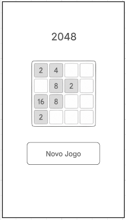
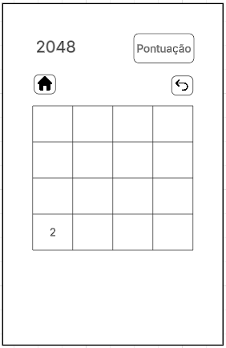
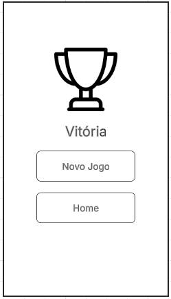
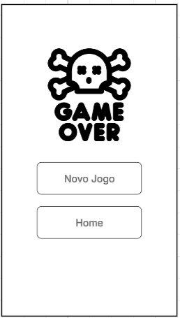
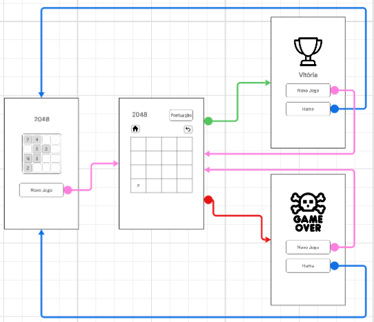

# Proposta do Aplicativo
Proposta de aplicativo para a matéria de Programação para Aplicativos Móveis de ADS - IFSC 2026.2

## (a) nome provisório
2048

## (b) problema que o aplicativo pretende resolver ou experiência de jogo que pretende oferecer
O aplicativo pretende oferecer uma experiência de entretenimento atráves de um puzzle/quebra-cabeça. O objetivo é juntar blocos com o mesmo valor, com os blocos iniciando com o valor 2 e finalizando com valor 2048.

## (c) público alvo
O aplicativo é destinado para qualquer pessoa que tiver interesse em jogos de lógica e quebra-cabeça rápidos.

## (e) descrição geral da solução proposta
O aplicativo apresenta um tabuleiro de 4×4 contendo blocos numerados(iniciados com o número 2). O jogador pode deslizar os blocos para cima, baixo, esquerda ou direita. Quando dois blocos com o mesmo valor se encontram, eles são unidos em um único bloco com o dobro do valor. Após cada movimento válido, um novo bloco é adicionado ao tabuleiro. O jogo termina quando não houver mais movimentos possíveis (derrota) ou quando o jogador atingir o bloco de valor 2048 (vitória).

## (e) principais dados manipulados pelo aplicativo ou estados relevantes do jogo
- Matriz 4x4
- Valor de cada posição do tabuleiro
- Soma dos valores dos blocos
- Pontuação atual do jogador (soma o valor de cada novo bloco criado quando dois números iguais se juntam)
- Estado do jogo (não iniciado, em andamento, vitória e derrota)
- Gerar novos blocos a cada movimento 

## (f) esboço inicial das telas ou fluxos previstos

### 1. Tela inicial

### 2. Tela do jogo

### 3. Vitória ou Derrota

### Fluxo esperado

1. Tela inicial
2. Tela de jogo
3. Se vitória -> tela de vitória; Se derrota -> tela de derrota
4. Ir para home ou iniciar novo jogo

Wireframes feitos no LucidChart.

## (g) funcionalidades ou mecânicas consideradas essenciais para a primeira versão

1. Iniciar novo jogo
2. Criar automaticamente novos blocos
3. Movimentação dos blocos
3. Desfazer movimentação
4. Contagem de pontuação
5. Verificar vitória ou derrota, redirecionando para a tela correta

## (h) conteúdos da disciplina que o aluno pretende utilizar

1. Programação em kotlin
2. Utilização do Android Studio
3. Interfaces com Jetpack Compose
4. Manipulação de estados

## (i) justificativa para as escolhas técnicas e funcionais previstas.

Foi escolhida a linguagem Kotlin por ser a linguagem oficial para o desenvolvimento Android e por ser utilizada na disciplina. A interface será desenvolvida com Jetpack Compose por facilitar a criação e atualização dos componentes visuais (e por ser o que está sendo ensinado na disciplina). As funcionalidades previstas para a primeira versão, como movimentação das peças e sistema de pontuação, foram escolhidas por serem elementos básicos e necessários para a implementação do jogo.

